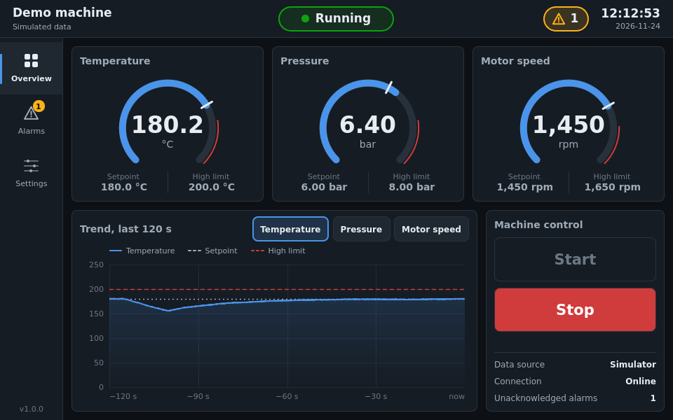
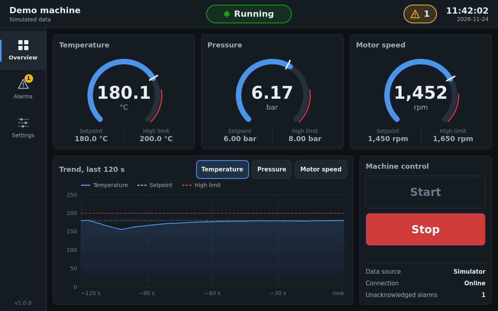
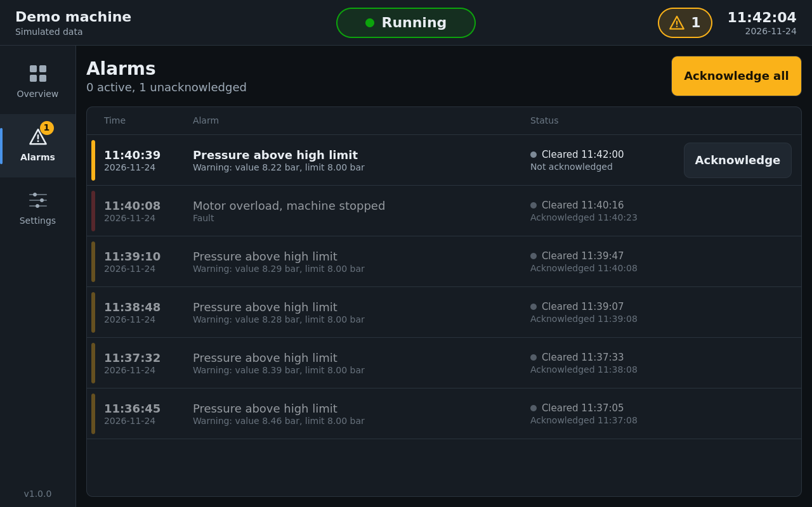
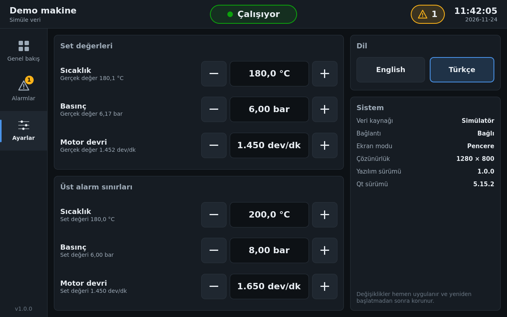

# Qt Kiosk HMI Demo

**English** | [Türkçe](README.tr.md)

[](https://github.com/caniyli/qt-kiosk-hmi-demo/actions/workflows/ci.yml)

A small touch-screen operator panel (HMI) for a machine, written in C++ and
Qt Quick (QML) and meant to run full screen on embedded Linux.

**This is a demo. All values come from a built-in simulator, not from a real
machine.** A Modbus TCP data source is included as an optional skeleton.



*Simulated run, recorded by the application itself: a motor overload stops
the machine, the fault is acknowledged in the alarm journal, the UI is
switched to Turkish and the machine is started again.*

| Overview | Alarm journal | Settings (Turkish UI) |
|---|---|---|
|  |  |  |

## What this demonstrates

- **UI separated from the data source:** the QML screens talk only to an
  abstract `MachineBackend`; the simulator and the Modbus TCP client plug in
  behind it without changes to the UI.
- **Alarm logic in C++, not in QML:** limit warnings with hysteresis, faults
  that stop the machine and block a restart until acknowledged, and a
  time-stamped alarm journal.
- **Testability:** the data layer is a separate library covered by Qt Test
  suites, and the simulator is deterministic for a fixed seed, which the
  tests, the screenshots and the animation above rely on.
- **Kiosk operation:** full-screen frameless mode, hidden cursor, a layout
  that scales to the panel size and an example systemd unit for starting at
  boot (not yet tried on a device).
- **Runtime language switch:** English and Turkish with Qt Linguist,
  including locale-aware number formatting.

## Features

- **Overview:** gauges for temperature, pressure and motor speed with setpoint
  marker and alarm zone, a trend of the last 120 s, machine state
  (Running / Stopped / Alarm) and Start/Stop.
- **Alarms:** time-stamped journal with active/cleared and acknowledged state;
  acknowledge one alarm or all. A fault stops the machine, which can be
  restarted only after the alarm is acknowledged; limit warnings do not stop it.
- **Settings:** setpoints and alarm limits edited with large -/+ buttons (no
  on-screen keyboard needed), English/Turkish switch at runtime with Qt
  Linguist translations and locale-aware numbers, settings kept across restarts.
- **Kiosk mode:** `--kiosk` (full screen, frameless) and `--hide-cursor`; an
  example systemd unit for starting at boot is in [`deploy/`](deploy/).
- 1280x800 design that scales to other panels (checked at 1024x600 and
  1920x1080). Everything is drawn in QML; no image or font files.

## Build and run

Requirements: CMake 3.16+, a C++17 compiler and Qt 5.12 or newer with Qt Quick,
the Qt Quick Controls 2, Layouts and Window QML modules and Qt Linguist tools.
Optional: Qt SerialBus (Modbus backend) and Qt Test (unit tests); both are
detected automatically.

```sh
cmake -S . -B build && cmake --build build && ./build/hmi-demo
```

For a Qt from the online installer add
`-DCMAKE_PREFIX_PATH=$HOME/Qt/5.15.2/gcc_64` to the first command.

```sh
./build/hmi-demo                          # 1280x800 window (default)
./build/hmi-demo --kiosk --hide-cursor    # full screen, as on the device
./build/hmi-demo --lang tr --size 1024x600
./build/hmi-demo --modbus 192.168.1.10:502   # real data, see below
./build/hmi-demo --help                   # all options
(cd build && ctest --output-on-failure)   # unit tests
```

Screenshots and the animation are produced by the application itself,
without a display. `scripts/take-screenshots.sh` runs it with
`QT_QPA_PLATFORM=offscreen` and `--screenshot <file>`, which first replays a
seeded seven-minute scenario (running, pressure surges, one motor overload
trip, restart). `scripts/make-demo-gif.sh` uses `--record <dir>` instead:
after the same scenario it plays a short scripted sequence (overload trip,
acknowledgement, switch to Turkish, restart), saves it as PNG frames at
10 fps (`--frames <n>` sets the count) and turns them into `docs/demo.gif`
with ffmpeg.

## Architecture

```
qml/pages/        screens, header and navigation; use only Machine and Language
qml/Hmi/Ui/       reusable controls: ArcGauge, TrendChart, Stepper, StatusPill, Theme
src/machinebackend   abstract QObject the UI talks to: values, state, alarms, commands
src/simulatedbackend plant model with noise, lags and random events (default source)
src/modbustcpbackend optional Modbus TCP client (built when Qt SerialBus is found)
src/processvalue     value, setpoint, high limit with hysteresis, ring-buffer history
src/alarmmodel       alarm journal as a QAbstractListModel
src/languagemanager  runtime language switch (QTranslator + QQmlEngine::retranslate)
```

## Connecting a real machine

The UI only knows `MachineBackend`. To use real data, derive a class from it,
call `publishSample(temperature, pressure, speed)` whenever new values arrive
(a poll cycle, an MQTT message, a serial frame), report status with
`setRunning()`, `setConnected()` and `setFault()`, and implement `start()`,
`stop()` and, if the controller owns the setpoints, `writeSetpoint()`. Then
create it in `createBackend()` in `src/main.cpp`. Limit alarms, the alarm
journal, trend history and the machine state shown on screen are handled by
the base class, so the QML code does not change.

`ModbusTcpBackend` is a worked example of this. It polls input registers
0-3 (temperature x0.1 degC, pressure x0.01 bar, speed in rpm, status bits),
reads and writes setpoints in holding registers 0-2 and uses coil 0 for
run/stop and coil 1 for fault reset; the map is documented in
`src/modbustcpbackend.h` and is meant to be adapted to the actual controller.
A lost connection raises an alarm and the client reconnects. It has been
tested only against an in-process `QModbusTcpServer` in the unit tests, not
against a real PLC. MQTT or Modbus RTU sources would follow the same pattern
(not included).

## Tests

`ctest` runs the Qt Test suites in `tests/`:

- `tst_simulatedbackend`: convergence to setpoints for several seeds, setpoint
  changes, coast-down after stop, limit warning raised and cleared, fault trip
  blocking restart until acknowledged, random events, determinism per seed.
- `tst_alarmmodel`, `tst_processvalue`: alarm states and acknowledgement,
  journal capacity, history ring buffer, setpoint rounding, limit hysteresis.
- `tst_modbustcpbackend` (with Qt SerialBus): register decoding, commands and
  setpoint writes, controller fault, connection loss and reconnect.

## Status and limitations

- Built and tested on Ubuntu 20.04 (x86_64) with Qt 5.15.2 and with the
  distribution's Qt 5.12.8. Not yet tested on ARM hardware or with Qt 6 (the
  CMake file has a Qt 6 path, but it has not been built).
- The systemd unit and boot notes in `deploy/` are examples and have not been
  tried on a device.
- The alarm journal is kept in memory only.
- An HMI is not a safety device: on a real machine, emergency stop and other
  safety functions must be implemented in hardware or a safety controller.

## License

MIT, see [LICENSE](LICENSE).
