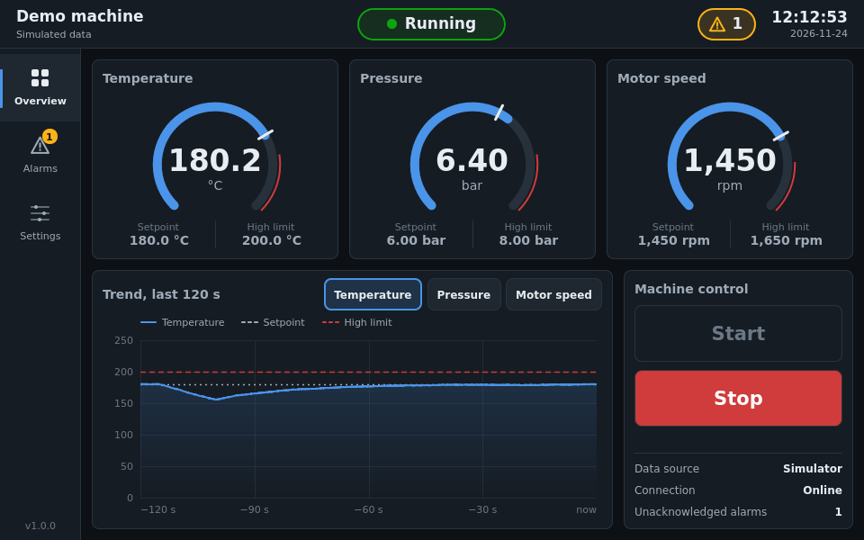
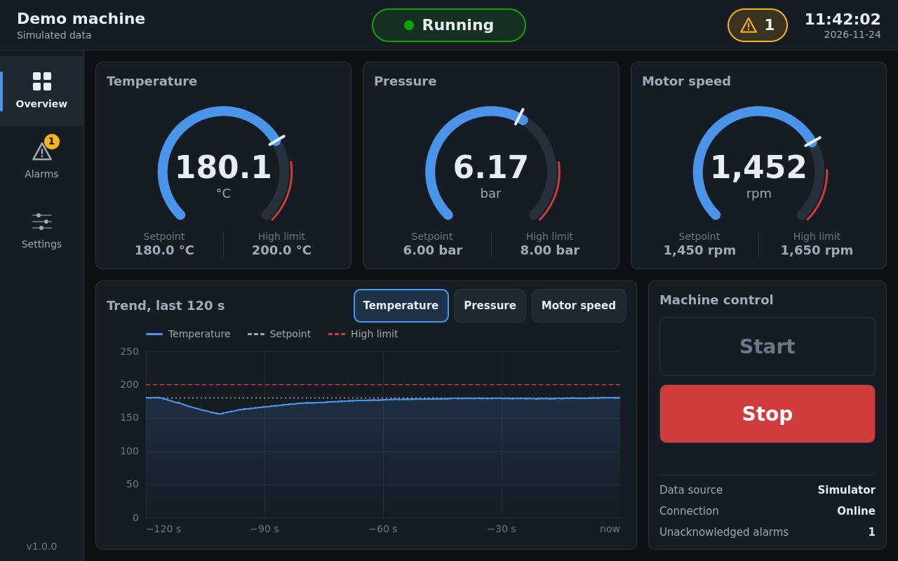
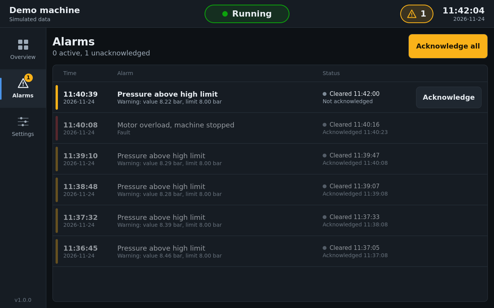
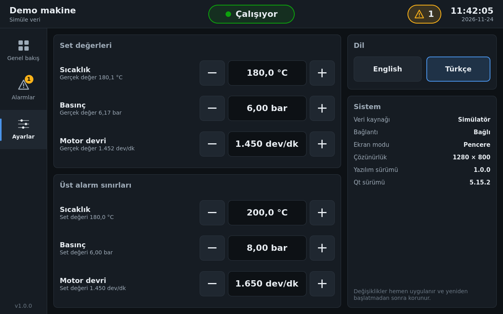

# Qt Kiosk HMI Demo

[English](README.md) | **Türkçe**

[](https://github.com/caniyli/qt-kiosk-hmi-demo/actions/workflows/ci.yml)

Bir makine için küçük bir dokunmatik operatör paneli (HMI). C++ ve Qt Quick
(QML) ile yazıldı; gömülü Linux üzerinde tam ekran çalışmak üzere tasarlandı.

**Bu bir demodur. Tüm değerler gerçek bir makineden değil, yerleşik bir
simülatörden gelir.** İsteğe bağlı bir iskelet olarak bir Modbus TCP veri
kaynağı da eklenmiştir.



*Uygulamanın kendisinin kaydettiği simüle bir çalışma: motor aşırı yükü
makineyi durdurur, arıza alarm günlüğünde onaylanır, arayüz Türkçeye
geçirilir ve makine yeniden başlatılır.*

| Genel bakış | Alarm günlüğü | Ayarlar (Türkçe arayüz) |
|---|---|---|
|  |  |  |

## Bu demo neyi gösteriyor

- **Arayüz veri kaynağından ayrı:** QML ekranları yalnızca soyut
  `MachineBackend` sınıfıyla konuşur; simülatör ve Modbus TCP istemcisi,
  arayüzde değişiklik gerektirmeden bu sınıfın arkasına takılır.
- **Alarm mantığı QML'de değil, C++'ta:** histerezisli sınır uyarıları,
  makineyi durduran ve onaylanana kadar yeniden başlatmayı engelleyen
  arızalar, zaman damgalı alarm günlüğü.
- **Test edilebilirlik:** veri katmanı Qt Test paketleriyle kapsanan ayrı bir
  kütüphanedir; simülatör sabit bir tohum (seed) değeriyle deterministik
  çalışır ve testler, ekran görüntüleri ve yukarıdaki animasyon buna dayanır.
- **Kiosk kullanımı:** çerçevesiz tam ekran modu, gizlenen fare imleci, panel
  boyutuna göre ölçeklenen yerleşim ve açılışta başlatma için örnek bir
  systemd birimi (henüz bir cihazda denenmedi).
- **Çalışma anında dil değişimi:** Qt Linguist ile İngilizce ve Türkçe,
  yerel ayara uygun sayı biçimlendirmesi dahil.

## Özellikler

- **Genel bakış:** sıcaklık, basınç ve motor devri için set değeri işaretli ve
  alarm bölgeli göstergeler, son 120 saniyenin trendi, makine durumu
  (Çalışıyor / Durdu / Alarm) ve Başlat/Durdur.
- **Alarmlar:** aktif/giderildi ve onay durumlarını gösteren zaman damgalı
  günlük; tek bir alarm ya da tümü onaylanabilir. Bir arıza makineyi durdurur
  ve makine ancak alarm onaylandıktan sonra yeniden başlatılabilir; sınır
  uyarıları makineyi durdurmaz.
- **Ayarlar:** set değerleri ve alarm sınırları büyük -/+ düğmeleriyle
  değiştirilir (ekran klavyesi gerekmez); Qt Linguist çevirileri ve yerel
  ayara uygun sayılarla çalışma anında İngilizce/Türkçe geçişi; ayarlar
  yeniden başlatmalarda korunur.
- **Kiosk modu:** `--kiosk` (tam ekran, çerçevesiz) ve `--hide-cursor`;
  açılışta başlatma için örnek bir systemd birimi [`deploy/`](deploy/)
  klasöründedir.
- Diğer panellere ölçeklenen 1280x800 tasarım (1024x600 ve 1920x1080'de
  kontrol edildi). Her şey QML ile çizilir; görsel ya da font dosyası yoktur.

## Derleme ve çalıştırma

Gereksinimler: CMake 3.16+, bir C++17 derleyicisi ve Qt Quick, Qt Quick
Controls 2, Layouts ve Window QML modülleri ile Qt Linguist araçlarını içeren
Qt 5.12 veya daha yeni bir sürüm. İsteğe bağlı: Qt SerialBus (Modbus arka
ucu) ve Qt Test (birim testleri); ikisi de otomatik olarak algılanır.

```sh
cmake -S . -B build && cmake --build build && ./build/hmi-demo
```

Çevrim içi yükleyiciyle kurulmuş bir Qt için ilk komuta
`-DCMAKE_PREFIX_PATH=$HOME/Qt/5.15.2/gcc_64` ekleyin.

```sh
./build/hmi-demo                          # 1280x800 pencere (varsayılan)
./build/hmi-demo --kiosk --hide-cursor    # cihazdaki gibi tam ekran
./build/hmi-demo --lang tr --size 1024x600
./build/hmi-demo --modbus 192.168.1.10:502   # gerçek veri, aşağıya bakın
./build/hmi-demo --help                   # tüm seçenekler
(cd build && ctest --output-on-failure)   # birim testleri
```

Ekran görüntüleri ve animasyon, ekran gerekmeden uygulamanın kendisi
tarafından üretilir. `scripts/take-screenshots.sh` uygulamayı
`QT_QPA_PLATFORM=offscreen` ve `--screenshot <file>` ile çalıştırır; bu
seçenek önce tohumlu, yedi dakikalık bir senaryoyu (çalışma, ani basınç
yükselmeleri, bir motor aşırı yük arızası, yeniden başlatma) oynatır.
`scripts/make-demo-gif.sh` ise `--record <dir>` kullanır: aynı senaryonun
ardından kısa, betiklenmiş bir akışı (aşırı yük arızası, onay, Türkçeye
geçiş, yeniden başlatma) oynatır, bunu saniyede 10 kare olarak PNG
dosyalarına kaydeder (`--frames <n>` kare sayısını belirler) ve ffmpeg ile
`docs/demo.gif` dosyasına dönüştürür.

## Mimari

```
qml/pages/        ekranlar, üst çubuk ve gezinme; yalnızca Machine ve Language kullanır
qml/Hmi/Ui/       yeniden kullanılabilir kontroller: ArcGauge, TrendChart, Stepper, StatusPill, Theme
src/machinebackend   arayüzün konuştuğu soyut QObject: değerler, durum, alarmlar, komutlar
src/simulatedbackend gürültü, gecikmeler ve rastgele olaylar içeren süreç modeli (varsayılan kaynak)
src/modbustcpbackend isteğe bağlı Modbus TCP istemcisi (Qt SerialBus bulunursa derlenir)
src/processvalue     değer, set değeri, histerezisli üst sınır, halka tampon geçmişi
src/alarmmodel       QAbstractListModel olarak alarm günlüğü
src/languagemanager  çalışma anında dil değişimi (QTranslator + QQmlEngine::retranslate)
```

## Gerçek bir makineye bağlanma

Arayüz yalnızca `MachineBackend` sınıfını tanır. Gerçek veri kullanmak için
bu sınıftan bir sınıf türetin; yeni değerler geldiğinde (bir sorgulama
döngüsü, bir MQTT mesajı, bir seri port çerçevesi)
`publishSample(temperature, pressure, speed)` çağırın; durumu `setRunning()`,
`setConnected()` ve `setFault()` ile bildirin; `start()`, `stop()` ve set
değerleri kontrol ünitesine aitse `writeSetpoint()` işlevlerini uygulayın.
Ardından sınıfı `src/main.cpp` içindeki `createBackend()` işlevinde
oluşturun. Sınır alarmları, alarm günlüğü, trend geçmişi ve ekranda
gösterilen makine durumu temel sınıf tarafından yönetilir; bu nedenle QML
kodu değişmez.

`ModbusTcpBackend` bunun çalışan bir örneğidir. 0-3 numaralı input
register'ları sorgular (sıcaklık x0,1 °C, basınç x0,01 bar, devir rpm
cinsinden, durum bitleri), set değerlerini 0-2 numaralı holding
register'lardan okuyup bunlara yazar, çalıştırma/durdurma için coil 0'ı ve
arıza sıfırlama için coil 1'i kullanır. Adres haritası
`src/modbustcpbackend.h` içinde belgelenmiştir ve gerçek kontrol ünitesine
göre uyarlanmak üzere hazırlanmıştır. Bağlantı koptuğunda bir alarm oluşur ve
istemci yeniden bağlanır. Yalnızca birim testlerinde aynı süreç içinde
çalışan bir `QModbusTcpServer`'a karşı test edilmiştir, gerçek bir PLC ile
denenmemiştir. MQTT veya Modbus RTU kaynakları da aynı yolu izler (dahil
değildir).

## Testler

`ctest`, `tests/` klasöründeki Qt Test paketlerini çalıştırır:

- `tst_simulatedbackend`: birkaç tohum değeri için set değerlerine yakınsama,
  set değeri değişiklikleri, durdurmanın ardından serbest yavaşlama, sınır
  uyarısının oluşması ve kalkması, onaylanana kadar yeniden başlatmayı
  engelleyen arıza, rastgele olaylar, tohum başına determinizm.
- `tst_alarmmodel`, `tst_processvalue`: alarm durumları ve onay, günlük
  kapasitesi, geçmiş için halka tampon, set değeri yuvarlama, sınır
  histerezisi.
- `tst_modbustcpbackend` (Qt SerialBus ile): register çözümleme, komutlar ve
  set değeri yazma, kontrol ünitesi arızası, bağlantı kaybı ve yeniden
  bağlanma.

## Durum ve sınırlamalar

- Ubuntu 20.04 (x86_64) üzerinde Qt 5.15.2 ve dağıtımın Qt 5.12.8 sürümüyle
  derlenip test edildi. Henüz ARM donanımında veya Qt 6 ile test edilmedi
  (CMake dosyasında bir Qt 6 yolu var, ancak hiç derlenmedi).
- `deploy/` içindeki systemd birimi ve açılış notları örnektir; bir cihazda
  denenmemiştir.
- Alarm günlüğü yalnızca bellekte tutulur.
- Bir HMI güvenlik cihazı değildir: gerçek bir makinede acil durdurma ve diğer
  güvenlik işlevleri donanımda veya bir güvenlik kontrolcüsünde (safety
  controller) gerçekleştirilmelidir.

## Lisans

MIT, bkz. [LICENSE](LICENSE).
